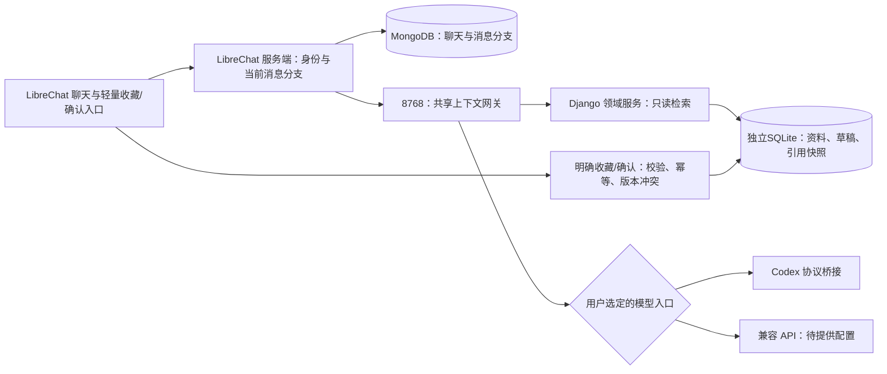
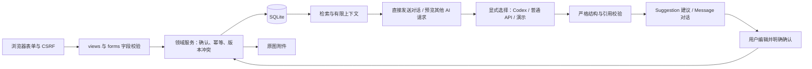

# 架构与数据流

## 当前架构（2026-10-18）

LibreChat + MongoDB 管理聊天，经本机上下文网关和 Codex 协议桥使用模型。新长期库为独立的 `data/librechat-library/workbench.sqlite3`，旧 Django/SQLite 保留。MongoDB 是聊天的事实源；新 SQLite 是已确认原则、长期收藏、经历、草稿和引用快照的事实源。

检索与写入位于提供器之前的网关，Codex bridge 仍不读数据库。未来第三方兼容 API 需把同一网关的下游替换为对应模型传输，不能从 LibreChat 直接绕过上下文层；目前尚未配置或实测第三方服务。

上游固定 v0.8.8，新增 TypeScript API 代理和轻量 React 组件，保留可重放补丁与验证脚本。网关用标准 OpenAI Chat Completions/SSE，聊天正文继续自然 Markdown；可选草稿从同一回答尾部提取，不追加判断或提炼模型调用。

### 存储与身份边界

- Source 对应素材，Principle/PrincipleVersion 对应原则；Observation 可独立保存，Decision 关联可选且使用 SET_NULL，不为经历编造选择。
- 普通附件属于聊天；明确收藏才把原件复制/导入受管理的长期存储，并保存校验值、类型、大小、来源消息/附件 ID。解析结果单列，失败保留原件。
- 原则与素材是可选多对多关系，不是强制逐条提炼；候选在 Suggestion，不混入已确认原则。为原则新增依据也创建新版本，保留旧版本的关联。
- LibraryEntry 保存 owner、领域对象身份、解析/索引投影及修订号，LibraryAsset 保存独立原件，LibraryEvidence 固定每个原则版本的来源/经历及摘录。API 代理从已登录 req.user.id 取身份；聊天网关验证服务器 token 与服务端模板 owner/chat/message 头，不信任浏览器提供 owner。
- 上游模板 messageId 是助手消息编号，每次重新生成有自己的引用快照；parentMessageId 是当前用户消息编号，用于明确写入的幂等操作与原始来源定位。自然确认只绑定当前消息分支上一条助手回答对应的明确草稿。
- 旧记录保持未分配、不可被新账号自动读取；用户明确选定归属、预览内容后才迁移/关联。测试账号仅访问独立测试记录。
- 模型提供器只接收经过授权的内容，没有写库权限。收藏/确认命令由服务端校验后调用领域服务，不执行模型输出中的任意命令。

### 检索和引用边界

默认以当前已采纳原则为主要参考，相关未关联素材、已确认经历可自动补充；不固定每轮发送三类记录。候选、停用原则和其他所有者记录不参与自动检索；试用原则仅在用户指定时可用。一次本地语义查询最多5条，原文摘录预算7000字符；实际召回的已整理素材另附最多400字摘要及主题。自动原则最多3条、素材和经历各最多2条；最低相似度0.48，并排除落后最佳匹配0.10以上的弱相关项。用户指定记录最多5条，仍检查归属与解析状态。

语义模型使用本地 BAAI/bge-small-zh-v1.5，FastEmbed/ONNX CPU 推理；OCR 为本地 RapidOCR，均不调用付费接口。原件先保存，OCR/索引由单后台线程处理；ready、pending、failed/blocked 分开报告，失败保留原件，可手动重试。首次需下载公开模型，运行时只读本地缓存。

检索返回有类型的记录 ID、具体版本、来源摘录和权限内查看地址；回复绑定本次引用快照。对历史分支、排除项、停用状态与记录修订进行校验。只有本次实际传入且仍获准使用的 ID 可显示为引用，不能把模型编造的 ID 当成事实。

长期检索失败时提示本轮未使用个人资料，仍可普通聊天；用户明确指定的记录不可读时直接提示检查状态，不调用模型冒充已读。移除、排除、修订后的历史助手回答按已记录的答案哈希失效，不把旧引用重新注入。原始用户输入仍属于用户当下明确提供的上下文。

LibraryTurn 保存输入指纹、短期处理中租约、完整答案与引用快照；同消息号同输入可回放完成结果，不重复调用模型，不同输入冲突。上游中断不保存半份草稿；上游已完成而浏览器断线时，可回放完整答案。草稿只能引用本轮实际提供的素材/经历/原则版本；确认才写入正式记录。默认每个对话最多一次自动提议，跨对话20分钟间隔；明确请求草稿不受自动频次限制。

JSON 导出按账号包含原件 base64/校验值、每版原则依据、经历、草稿状态、对话排除设置及回答引用快照。回收站可恢复，不自动永久删除。新旧库独立，不自动迁移；旧 Django 删除入口无法触及新长期库。

### 收藏后自动整理（2026-10-18）

LibraryOrganization 一对一附于素材，独立保存任务状态、来源修订、模型、租约和整理结果，不修改 Source 原文、原则版本或 Observation。新收藏创建 pending 任务；旧记录没有任务，只有用户点击整理后才创建。索引/OCR线程完成后，独立 OrganizationWorker 按顺序处理；仅一条后台模型任务并发，数据库任务可在重启后恢复。超时、无效输出不会无限重试；过期运行租约最多恢复3次，失败需用户点击重试。

模型适配器复用 LibreChatBridge 的只读、无工具 Codex 协议，但创建独立实例，避免占据前台聊天的单请求锁。每份素材正常调用一次模型，保留 gpt-6.1-sol / medium，模型仅返回 JSON。程序验证字段、长度、来源ID与引文的字面匹配；只允许本次提供的同账号、未移除素材候选形成关联。租约token、来源修订与关联来源状态共同防止过期结果写回。程序不能验证概括的全部语义，界面明确要求核对原文。

摘要、最多8个要点、最多5个主题、最多4条材料关联和不确定性说明作为AI派生笔记保存。检索仍以原始文字为基础，当前有效摘要最多400字随相关素材附入上下文，并标记为AI整理；不能把它作为新的个人事实源。导出自动包含整理结果。手动重新整理失败时，保留上一份结果并标注未更新。

资料库新增独立素材表单；通过已登录代理的 /sources 入库，不接受客户端指定所有者或文件系统路径。直接表单附件合计2MB，保持低于上游原有3MB JSON解析上限；更大文件沿用聊天上传后收藏。/entries/:id/organize 仅重新排队，不在HTTP请求内等待模型。

## 旧 Django 工作台架构（历史实现，仍保留）

下文只描述 8765 旧端。其 UI、Case/Message 上下文范围、high 默认和 JSON 输出规则不代表 3081 新聊天；新聊天当前为 gpt-6.1-sol / medium。新功能以 PRODUCT.md 和本页上述边界为准。

采用 Django 模板应用、少量原生 JS、SQLite 与文件附件。单进程同步请求，避免引入任务队列、向量数据库、独立前端服务或 Agent 框架。

## 文件职责

| 位置 | 职责 |
|---|---|
| `config/` | 数据位置、SQLite、环回主机、CSRF、静态资源、路由 |
| `workbench/models.py` | 明确对象、关联、原则版本不可修改的 ORM 规则 |
| `workbench/services/common.py` | 事务、操作去重、条件更新冲突、明确确认 |
| `services/sources.py` | 原文与原图先存、图片格式检查、元数据与校对 |
| `services/principles.py` | 原则稳定身份、不可覆盖版本、状态、关注 |
| `services/records.py` | 情境、引用、聊天自述、正式选择、后续观察 |
| `services/chat.py`、`views/chat.py`、`static/workbench/chat.js` | 直接发送、先存原话、流式回复、原地续聊与失败重试 |
| `services/retrieval.py` | 可解释的中文双字词/英文词与标签重合检索 |
| `services/ai.py` | 按任务组装上下文、预算裁剪、生成前后陈旧检查、建议确认 |
| `services/ai_settings.py` | 合并 UserSettings 与环境覆盖，选择 Codex、普通 API 或演示模式 |
| `ai/provider.py`、`ai/codex_provider.py`、`ai/codex_auth.py`、`ai/prompts.py`、`ai/validation.py` | 无数据库访问的提供器选择、Codex 登录/只读会话、提示组装与 JSON schema 校验 |
| `services/data_admin.py` | 全量 ZIP、按实体类型判断删除引用、影响签名、提交后附件删除 |
| `forms.py`、`views/` | 输入与请求边界，不直接根据 AI 文本修改正式档案 |
| `templates/`、`static/` | 中文页面、可见确认、渐进详情、响应式与提交反馈 |

## 关系与约束

- `Source` 保存原文、链接、原图、单独的校对文字及来源核实状态。
- `Principle` 保留稳定 ID；`PrincipleVersion` 保存标题、表述、类型、状态、条件、边界、问题、理由、来源与演示标记。数据库触发器拒绝任何 UPDATE；状态调整也创建版本。
- `Case` 的引用集合可编辑；`Message` 区分用户自述与 AI 建议，AI 消息保留本次引用 ID。移除参考后，后续上下文不会因历史 AI 文字又引入被移除的引用。
- `Decision` 保存用户明确确认的选择、理由与期待，M2M 指向具体 `PrincipleVersion`。
- `Observation` 分别保存发生的事、用户解释、未知、期待差异与支持/不支持/不判断的关系，不覆盖 Decision。
- `Suggestion` 与正式对象分表，记录任务、上下文、payload、生成时修订号、演示状态、是否确认或放弃及保存结果。修订从当前版本开始，同时提供同一原则的历史选择依据。
- `UserSettings` 保存单次检索与字符预算，并明确选择 `ai_provider`（`codex`、`api` 或 `demo`）和 `codex_model`、`codex_reasoning_effort`。`AI_PROVIDER`、`CODEX_MODEL`、`CODEX_REASONING_EFFORT`、`CODEX_TIMEOUT` 可用环境变量覆盖；默认是 Codex 与 `gpt-6.1-sol` / high，没有自动回退。已确认价值取向是 `kind=value` 且 `status=adopted` 的版本，不构建隐形个人画像。
- `Operation` 用 UUID 与输入摘要去重；记录被删除后操作标记可保留，以阻止迟到的重试把删除内容恢复。

写入事务使用 SQLite `IMMEDIATE`，在读取修改状态前取得写锁，条件更新同时检查 revision。模型 HTTP 调用在事务之外；返回后重新核对原始内容与引用，变化即拒绝保存旧结果。重复成功请求复用已保存结果；浏览器提交时禁用按钮。没有自动重试远程请求。

Codex 请求使用统一截止时间，包含认证查询、配置核验、thread/turn 建立和事件读取；单个准备 RPC 最多等待 30 秒。无文本事件时每秒发出一个状态事件，让 HTTP 层发现断开的页面。取消、错误和超时统一关闭本次请求独占的 SDK app-server，不同步调用无超时的 `turn/interrupt`。关闭本身也有等待上限，必要时只终止该 SDK 实例持有的子进程；之后释放生成与聊天锁，未完成的输出不落库。

直接聊天使用 CSRF 保护的 `POST /chat/send/` 或 `POST /cases/<id>/send/`，必须明确 action=send/save。发送按钮替代聊天专用的预览/勾选步骤；设置签名阻止旧页面在不知情时切换提供商。一个用户操作号绑定原话、情境、修订号，派生输入与回复的操作号：先把输入存入 SQLite，再在事务外调用已有 AI 服务。NDJSON 返回 saved/status/delta/complete/error；只有完整且校验通过的回复才保存。页面收到 complete 后用 Django 渲染且已转义的片段更新，原始模型内容不会作为 HTML 执行。失败重试复用相同操作号，断线后已有回复可直接取回；正式对象的确认机制保持原样。

单次检索最多选择 1–10 个原则和经历，默认 5。普通 API / 演示使用 2,000–50,000 字符预算，默认 12,000；过长文字截短并标记。Codex 不使用此字符预算，容量遵循原生模型窗口。原始记录不改变。AI 只接收字典形式的当前问题、选中内容和近期最多 12 条消息，不发送整个库或原始附件；SQLite 保存全部业务记录和引用关系，并负责重建多轮上下文。

Codex 每次调用创建 `ephemeral` 会话和临时目录，不恢复 SDK 历史。启动前逐项关闭并核验继承的 MCP、工具 feature、网络搜索、skill 指令；同时使用只读 sandbox 和 `deny_all` 审批。普通 API 走兼容 Chat Completions 的完整 JSON 响应，Codex 走受限 NDJSON delta；两者都必须通过严格 schema 和真实引用校验。提供器没有数据库写权限，正式写入仍由人工确认后的 Django 服务完成。

## 有意保留的第一版边界

没有 OCR、网页抓取、向量搜索、自动导入、公开部署或后台推送。Codex 官方 OAuth 登录流程已实现，但未用当前账号退出后做新账号人工登录验收；普通 API 与 DeepSeek 等具体供应商的真实连通、兼容性、费用和质量尚未验证。关键词匹配可能漏匹配或误匹配，界面允许用户修正。单次上传与文本输入有资源上限，不限制记录总量。长时间备份会占用 SQLite 事务，适用于单人本机规模。

参考官方资料：[Codex SDK](https://learn.chatgpt.com/docs/codex-sdk)、[认证](https://learn.chatgpt.com/docs/auth)、[Windows sandbox](https://learn.chatgpt.com/docs/windows/windows-sandbox)。

Codex 使用原生模型上下文窗口和压缩配置，工作台不再做字符截短；普通 API/演示保留字符预算。检索数量、当前选中引用和最近消息范围仍独立受控。推理强度由 `codex_reasoning_effort` 保存并显式传给 SDK turn 的 effort 参数。
